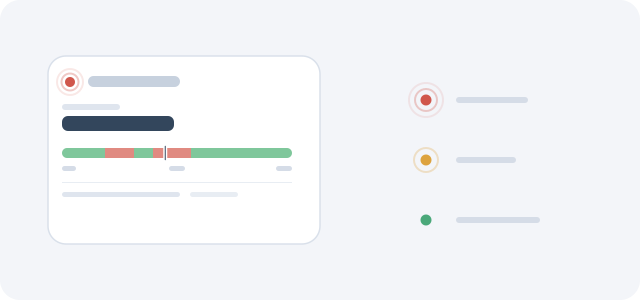

# Peak Reminder

A DeepSeek Harness plugin that keeps DeepSeek's API price window visible in the conversation header, and adds two workday conveniences: desktop notifications for replies and questions, and a right-to-left switch for conversation text.



## What it does

**Peak status.** A small dot sits in the conversation header and reports DeepSeek's billing window.

| State | Dot | Meaning |
|---|---|---|
| Peak | red, pulsing | inside a peak window |
| Soon | amber, ringed | less than 30 minutes until a peak starts |
| Off-peak | green, steady | everything else, including weekends and Chinese public holidays |

Click it for a card with the countdown to the next change, a 24-hour ribbon of the current local day, and the peak windows in your own time zone. The four points where peak flips are hoverable — and focusable by keyboard — to name the exact time of each change. A one-shot toast announces the moment a peak begins.

**Notifications.** A desktop notification arrives when a reply finishes or when the agent asks a question, so you can work elsewhere while DeepSeek runs. The window is left alone while it has focus, where the conversation already shows the result.

**Right-to-left text.** Answers, the questions you write, the session-list titles, and the agent's multi-choice questions with their options all read right to left. Code blocks and formulas stay left to right. Both switches live in the card and are remembered per browser.

## Install

Install from GitHub — the repository root is the plugin package:

```
Plugins → Add plugin → github:Amir-Keshtkar/PeakReminder
```

The same identifier works from a shell:

```
plugin_manager install_bundle: github:Amir-Keshtkar/PeakReminder
```

For development, point the installer at the working copy instead and the running app picks up edits:

```
plugin_manager install_bundle: C:\Users\Amiri\Documents\VS Code\PeakReminder
```

Restart DeepSeek Harness after the first install so the Host half loads.

## Keeping the schedule current

DeepSeek publishes no pricing API, and the docs site sends no CORS headers, so the schedule cannot simply be fetched from the browser's page. Three layers handle it, and every one of them degrades to the next without breaking the display:

1. **`schedule.json` in this repository** is fetched by the plugin at load (with a six-hour cache). It is served by `raw.githubusercontent.com`, which does allow cross-origin reads, so a GitHub-installed copy follows the schedule without being reinstalled. The response is validated — two usable, non-overlapping windows inside one day — and anything else is ignored.
2. **The Host half** re-reads the official page at activation and every twelve hours and rewrites `client.js` and `schedule.json` when the windows changed. This is what keeps a linked working copy current. A packed install is not writable, so it relies on layer 1.
3. **`scripts/sync-schedule.mjs`** does the same work from a terminal, for CI or a cron:

   ```
   npm run sync                             # update client.js and schedule.json
   node scripts/sync-schedule.mjs --check   # report drift; exit 1 when stale
   ```

The parser reads the exact sentence the official page uses — `Peak hours are 01:00 - 04:00 and 06:00 - 10:00 UTC, Monday through Friday, excluding Chinese public holidays.` — in English or Chinese, and refuses to write anything it cannot parse. A change to the *rule* itself (weekdays, holiday exclusion) is reported as a warning rather than silently adopted, because the code, not the page, implements it.

## Configuration

The schedule and the amber lead-in are three constants at the top of `client.js`:

```js
const PEAK_WINDOWS_UTC_MINUTES = [[60, 240], [360, 600]]; // 01:00–04:00, 06:00–10:00 UTC
const LEAD_MINUTES = 30;                                  // when the dot turns amber
const CHINA_HOLIDAY_RANGES = [['2026-01-01', '2026-01-03'], /* … */];
```

`CHINA_HOLIDAY_RANGES` holds the State Council's 2026 holiday dates. Add the next year's dates when they are published; until then those days are treated as ordinary weekdays. Holidays are the one part of the schedule that no official machine-readable source provides, so this list is maintained by hand.

The two switches in the card (RTL text, notifications) persist in `localStorage`.

## Tests

No browser is required:

```
node --check client.js
node --check index.js
node --check scripts/sync-schedule.mjs

TZ=Asia/Tehran node tests/time-model.test.cjs   # 16 boundary cases, ribbon, hover points
TZ=Asia/Tehran node tests/locales.test.cjs      # dictionary parity, manifest, input validation
node scripts/sync-schedule.mjs --check          # the repo matches the official page
```

`time-model.test.cjs` slices the time model out of `client.js` and runs it, so the assertions cannot drift from the shipped code.

## Limitations

- Notifications are suppressed while the window has focus.
- The RTL selectors match attribute hooks and CSS-module local names; a rename upstream would narrow them, not break rendering.
- Chinese holiday dates are a maintained list, as noted above.

## Layout

| File | Role |
|---|---|
| `client.js` | the dot, the card, the toast, notifications, RTL, and the time model |
| `index.js` | Host half; refreshes the schedule from the official page |
| `schedule.json` | the published windows the plugin fetches at runtime |
| `scripts/sync-schedule.mjs` | the same refresh, for a terminal or a cron |
| `cordis.patch.yml` | the plugin row in the profile |
| `locale/en.json`, `locale/zh.json` | display metadata for the Plugin Manager |
| `docs/preview.svg` | the single image on the plugin's detail page |

The plugin reads no session content; the only outbound requests are the official pricing page (Host) and `schedule.json` (browser).
